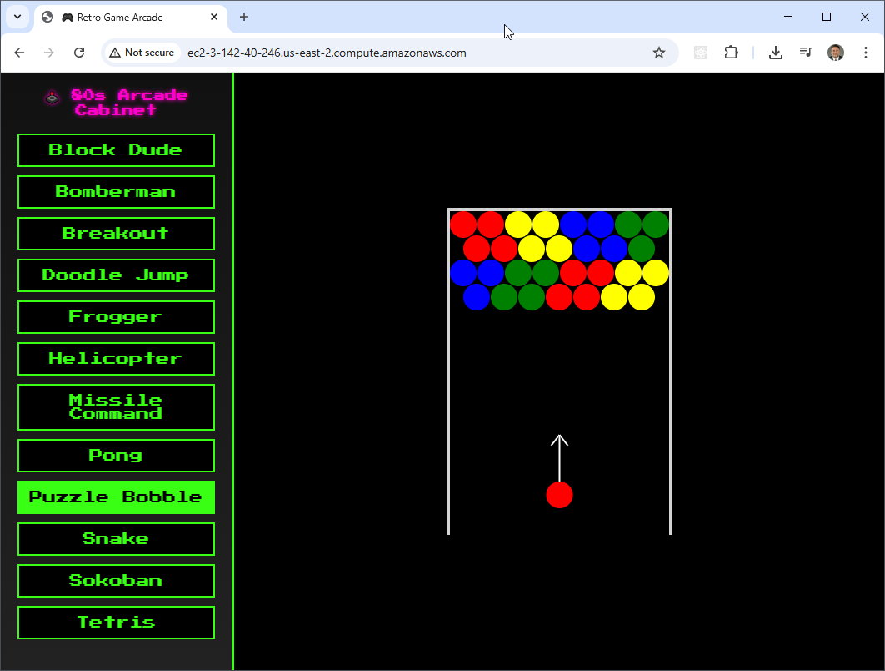
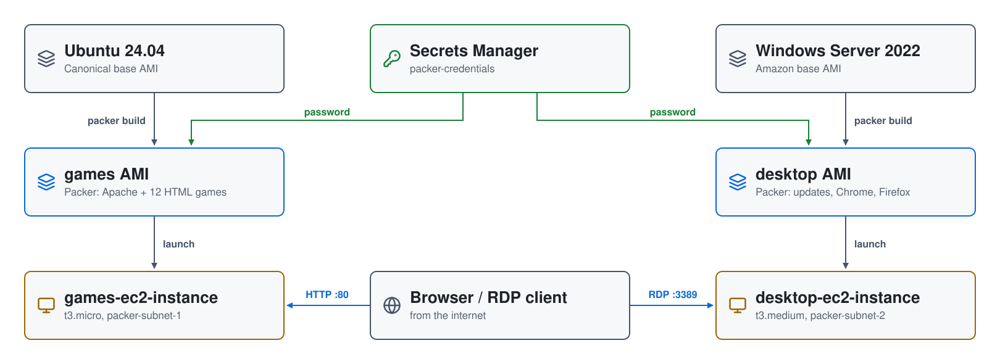
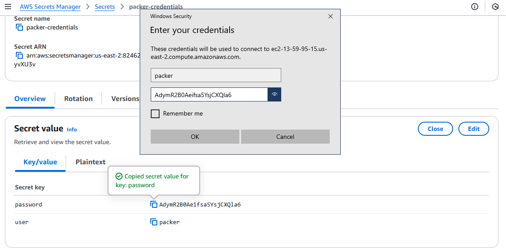
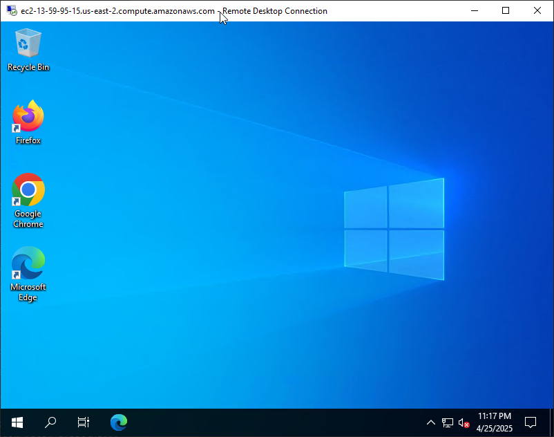

# Building AMIs with Packer on AWS

Two custom images built with **Packer** and deployed with **Terraform**: a
Linux **games** AMI, Ubuntu 24.04 with Apache serving a dozen retro HTML
games, and a Windows **desktop** AMI, Windows Server 2022 with the latest
updates, Chrome and Firefox. Both images carry a local `packer` account whose
password comes from Secrets Manager, and Terraform launches one server from
each.



| Piece | Where | Role |
|---|---|---|
| **games AMI** | `games_ami_<timestamp>` | Ubuntu 24.04 + Apache + 12 HTML games, SSM agent enabled, `packer` sudo user |
| **desktop AMI** | `desktop_ami_<timestamp>` | Windows Server 2022 + Windows updates, Chrome, Firefox, `packer` admin user; sysprepped with EC2Launch |
| **games-ec2-instance** | `packer-subnet-1` (us-east-2a) | `t3.micro` from the newest games AMI; HTTP, HTTPS and SSH open |
| **desktop-ec2-instance** | `packer-subnet-2` (us-east-2b) | `t3.medium` from the newest desktop AMI; HTTPS and RDP open |
| **Secrets Manager** | regional | `packer-credentials`: the `packer` user and a generated password |

## Architecture

<picture>
  <source media="(prefers-color-scheme: dark)" srcset="architecture-dark.svg">
  
</picture>

Regenerate with `python3 make_diagram.py`.

- **`01-infrastructure/`**: the VPC (`packer-vpc`, 10.0.0.0/24) with two
  public subnets, the security groups, and the `packer-credentials` secret.
- **`02-packer/linux/`**: `linux_ami.pkr.hcl`, the HTML games, and the
  install and user scripts.
- **`02-packer/windows/`**: `windows_ami.pkr.hcl` and the PowerShell
  provisioners.
- **`03-deploy/`**: the two EC2 instances, launched from the newest
  `games_ami*` and `desktop_ami*` images, and their SSM instance profile.

## How the images are built

**Linux** (`m5.large` build instance, 16 GB gp3):

1. Copies `html/` to the instance and installs Apache, which serves the games
   from `/var/www/html`.
2. Enables the SSM agent snap.
3. Creates the `packer` user with the secret's password and passwordless sudo.

**Windows** (`m5.large` build instance, 64 GB gp3):

1. Boots with a user-data script that sets the Administrator password and
   configures WinRM over HTTPS, which Packer uses to connect.
2. Installs every available Windows update, then reboots.
3. Creates the `packer` user in Administrators and Remote Desktop Users,
   installs Chrome and Firefox, and removes the EC2 desktop shortcuts.
4. Resets and syspreps the image with EC2Launch, so each server boots clean.

## Security groups

```
internet ─80, 443, 22─▶ games-ec2-instance
internet ─443, 3389──▶ desktop-ec2-instance
```

All four groups (`packer-sg-http`, `-https`, `-ssh`, `-rdp`) allow
`0.0.0.0/0`. The games server's user data turns on SSH password logins, so
`packer` can sign in over SSH as well as SSM.

## Prerequisites

* [An AWS Account](https://aws.amazon.com/console/)
* [Install AWS CLI](https://docs.aws.amazon.com/cli/latest/userguide/getting-started-install.html)
* [Install Terraform](https://developer.hashicorp.com/terraform/install)
* [Install Packer](https://developer.hashicorp.com/packer/install)
* [Install jq](https://jqlang.github.io/jq/download/)

If this is your first time watching our content, we recommend starting with
this video: [AWS + Terraform: Easy Setup](https://youtu.be/BCMQo0CB9wk).

## Deploy

```bash
git clone https://github.com/mamonaco1973/aws-packer.git
cd aws-packer
./apply.sh       # 1: VPC + secret  2: games and desktop AMIs (Packer)  3: EC2 instances
```

Everything deploys to `us-east-2`. The Packer phase takes the longest, at
least 20 minutes, most of it Windows updates. Each run of `apply.sh` builds
new AMIs, and phase 3 always uses the newest. `apply.sh` ends by running
`validate.sh`:

```
NOTE: Games URL is http://ec2-203-0-113-10.us-east-2.compute.amazonaws.com
NOTE: Games server FQDN is ec2-203-0-113-10.us-east-2.compute.amazonaws.com
NOTE: Windows server FQDN is ec2-203-0-113-20.us-east-2.compute.amazonaws.com
```

## Try it

1. Open the **Games URL** and pick a game.
2. Get the `packer` password:

   ```bash
   aws secretsmanager get-secret-value --secret-id packer-credentials \
     --query SecretString --output text | jq -r .password
   ```

3. RDP to the **Windows server FQDN** as `packer`:

   

   

## Troubleshooting

| Symptom | Fix |
|---|---|
| The Windows build sits at "Waiting for WinRM" | The user-data script configures WinRM on first boot; give it several minutes. Packer's temporary security group opens 5986; check that outbound 5986 isn't blocked where you run Packer. |
| The Windows build takes a long time | Windows updates and the reboot after them. Expected. |
| `03-deploy` can't find an AMI | A Packer build failed; re-run `apply.sh` and read the Packer output. |
| The games page doesn't load | `aws ssm start-session --target <instance-id>`, then `systemctl status apache2`. |

## Teardown

```bash
./destroy.sh     # destroys the servers, deregisters the AMIs and deletes their snapshots, deletes the secret, destroys the VPC
```

## Notes

- **Lab only.** HTTP, SSH and RDP are open to the internet, the `packer`
  account is an administrator on both images, and the Windows build turns on
  unencrypted WinRM with Basic auth. Restrict the security groups for
  anything more.
